# MiniHou

The combined Claude/Codex version and node-name compatibility notes are documented in [Master integration](docs/MASTER_INTEGRATION.md).

**Wired Geometry Nodes groups:** MiniHou can now process the actual mesh wired into a group inside a native GN
network, including multiple independently configured placements, nested groups and branches. Blender evaluates
each native input subgraph on a disposable copy; the external engine computes it and publishes a private result
for downstream nodes. This is a staged interactive bridge, not a synchronous Python GN execution callback.
See [usage, runnable example and supported limits](docs/GEONODES.md). Cook explicitly before rendering.

### Modelling workflows

The modelling additions include edge groups, Poly Bridge, Dissolve, Skin/Loft,
Poly Expand 2D, Soft Transform, Lattice, Point Deform and subdivision creases.
See [tool contracts and limits](docs/modeling_tools.md) before applying them to
production geometry; these initial implementations do not claim Houdini parity.

Run `python examples/modeling_workflows.py` to cook all eight examples. Open an
individual workflow in the editor with:

```powershell
python tools/worktree_cli.py serve examples/graphs/modeling_bridge.json --port 0 --http-port 0
```

Use the printed ports to connect Blender and open the editor. The wrapper loads
this checkout explicitly, including with an embedded runtime whose `_pth` points
elsewhere. In the isolated Windows worktree, replace `python` with
`& 'C:\Users\Graham\Documents\MiniHou\build\runtime\python312\python.exe'`.

* **Bridge:** create two `edge_group` nodes using primitive selections `0` and
  `1`, then set Poly Bridge source/destination to their group names. Change
  `segments` for intermediate rings; `twist` changes closed-loop correspondence.
* **Dissolve:** create an edge group with method `boundary`, then dissolve
  `^boundary` on a flat grid. UV/material seams are protected by default.
* **Loft:** merge several equal-count Circle or Curve profiles in order, then
  append Skin. Poly Expand 2D can offset a convex closed profile upstream.
* **Deform:** branch a `lattice_grid` into a rest and edited copy, then connect
  the model/rest/edited branches to Lattice. Point Deform uses the same wiring
  with a small arbitrary control cloud. Soft Transform edits controls or models.
* **Crease:** append Crease before Subdivide. Edge sharpness and point corner
  weights decay one unit per level; `use_creases` compares against smooth output.

The examples are named `examples/graphs/modeling_*.json`. Parameter tooltips and
node descriptions are supplied by the registry. Run isolated regressions with
`python tools/test_worktree.py`; actual Blender geometry/protocol smoke tests use
`blender --background --factory-startup --python-exit-code 1 --python tools/blender_modeling_smoke.py`.

A small, standalone **procedural geometry engine** in Python (numpy, optionally numba) that **live-links into Blender 5.1/5.2**.
You build a node graph in a **browser node editor**, by hand in JSON, or by **asking an AI** (built-in MCP server); the engine cooks
it and the result streams into Blender as a mesh you can drive with Geometry Nodes. Change anything, anywhere (editor, AI, JSON
file, a modifier slider in Blender) and only what changed is recooked and re-sent; every other view follows live.

```
 node editor (browser) ──┐  HTTP + live events     engine process (minihou)     TCP 127.0.0.1:8765
 AI assistant (MCP)  ────┼─ 127.0.0.1:8766 ──────►  pull-based cooking   ───────────────────────►  Blender add-on
 graph.json  ◄───────────┘  (edits, undo, inspect)  hash-keyed cache       changed arrays only      proxy + Geometry Nodes
                            ◄── saved / hot-reloaded                  ◄─── modifier slider drags ──  inputs = exposed params
```

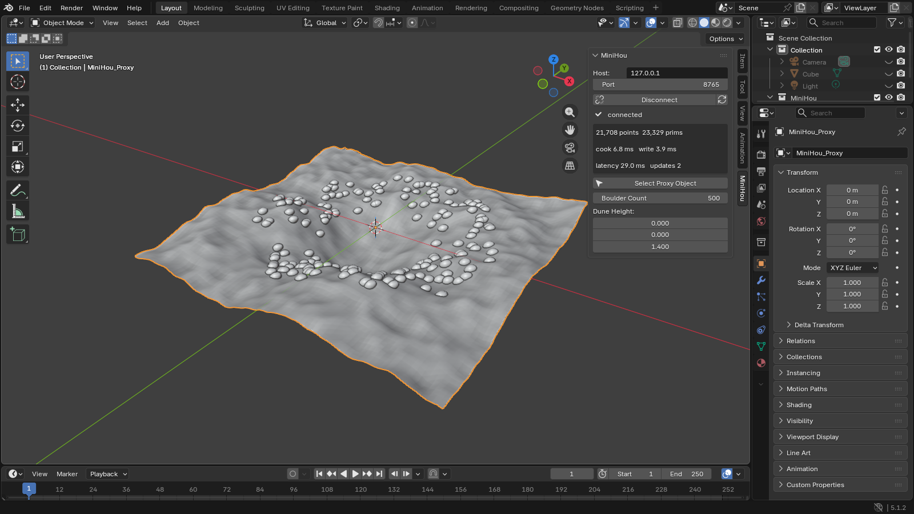

Status: 90+ node types covering Houdini's everyday toolkit (wrangle, groups, polygon modelling with exact booleans,
bevel and reduce, curves, UV unwrapping, volumes, fracture, instancing, for-each and solvers) plus an Unreal-style PCG
point toolkit; node editor, MCP server, Blender objects as live inputs.
Every push runs CI on Linux and Windows, including the add-on inside a real Blender 5.1.2 on Windows
(`.github/workflows/ci.yml`). Design notes and next steps: [docs/PLAN.md](docs/PLAN.md).

## Quick start (Windows)

You need Python 3.11+ and Blender 5.1.

```powershell
git clone https://github.com/grahamwheaton/MiniHou.git
cd MiniHou
py -m pip install numpy numba scipy    # numba and scipy are optional: faster heavy nodes and nearest-point queries

py -m unittest discover -s tests -t .  # engine tests (no Blender needed)
py tools\launch_blender.py --engine examples\graphs\demo.json --editor
```

The launcher finds Blender (Program Files, per-user installs, Steam, `PATH`, or `$env:BLENDER_EXE`), starts the engine,
and opens Blender with the add-on registered and connected. Press **N** in the viewport and open the **MiniHou** tab:
connection state, cook/write timings and the exposed parameters. The `MiniHou_Proxy` object carries a Geometry Nodes
modifier whose inputs are the same parameters (also editable, keyable and drivable in the modifier panel). Edit the
graph JSON in any editor and save: the engine hot-reloads it and only the changed nodes recook. `--editor` also opens the
**node editor** at <http://127.0.0.1:8766/> (the URL is printed either way).

**More than one result**: the display node is the main output (it flows through `MiniHou_Proxy`). Give any other `output` node an
`object` name (say `Trees`) and its geometry appears as its own mesh object of that name, updated live; remove the name (or the node)
and the object goes. The add-on only ever touches objects it made: an existing object of the same name is left alone and logged.
**Detail attributes** (one value per geometry: counts, measurements, a `for_each` iteration) arrive as `mh_<name>` custom properties
on `MiniHou_Output` (and on each named output's object), ready for drivers and scripts.

```powershell
$env:BLENDER_EXE = "C:\Program Files\Blender Foundation\Blender 5.1\blender.exe"   # if auto-detection misses it
py tools\launch_blender.py --find
```

Manual launch: `py -m minihou serve graph.json` in one terminal, then
`blender.exe --python tools\blender_bootstrap.py` (add `-- --port N` for another port). Permanent install:
`py tools\sync_addon.py`, zip `blender_addon\minihou_link`, *Edit > Preferences > Add-ons > Install from Disk*.

Errors in Blender's console from *other* add-ons (common on a new Blender version) are not MiniHou's; MiniHou's own lines
start with `[minihou]`. `--factory` starts Blender without your add-ons and preferences for a clean console.

Other commands: `py -m minihou nodes` (all node types and parameters), `py -m minihou cook graph.json` (cook once,
print timings and cache behaviour), `py -m minihou serve graph.json --open` (engine + editor, no Blender).

## Start the engine from Blender

Install the add-on, then set **External Python / Portable Runtime** and **MiniHou Project Folder** in its preferences
or the MiniHou sidebar. Choose a prepared Python 3.11+ executable with numpy and access to this checkout's `minihou`
package. A portable Python distribution works too, provided its import path includes the project (embedded Python
may require configuring its `_pth` file). The add-on never installs dependencies into Blender and has no dependency
on an agent's runtime or machine-specific path.

Choose a **Graph**, the link port (default 8765), and **Editor Port** (8766). **Start Server** reports startup,
readiness, import failures and process errors. It reuses an engine only when its protocol, instance capability,
graph path and editor address match. A different graph/server on the same port is reported as a conflict;
choose another port or the existing graph. **Open Editor** opens the ready engine in your external browser.
**Stop Owned Server** and disabling the add-on only terminate the process started by that add-on, never a reused server.
**Connect** still enables the original live proxy workflow independently.

## MiniHou modifiers on existing meshes

Select one or more editable mesh objects in Object Mode, choose `examples/modifiers/transform.json`, start the server,
then click **Add MiniHou Modifier**. Each click adds another independent Geometry Nodes modifier to each selected mesh.
Its exposed parameters appear in the normal modifier panel and the MiniHou sidebar. One engine serves all instances;
there is no process per modifier. The original mesh datablock is not replaced.

A modifier graph must have a `modifier_input` node connected upstream of its displayed output. This node receives the
evaluated mesh immediately before that MiniHou modifier, in object-local coordinates, including preceding native and
MiniHou modifiers. The cooked result is cached at that position, so subsequent modifiers receive it. For example,
a point at x=1, a native translation of +2, MiniHou scale of 2, and MiniHou translation of +4 evaluates to x=10.
Reordering scale and translation changes the result to x=14. A disconnected primitive generator is rejected as a
stack modifier; existing generator graphs continue to work through the proxy. `blender_object` is rejected in modifier
graphs to prevent feeding the object's final evaluated output back into its own stack.

Each modifier stores its own graph snapshot, parameters and identity in the blend file. Duplicated objects/modifiers
receive new identities and private caches on the next update. **Edit Network** opens a live session for that
modifier, including its actual preceding-stack geometry. Browser changes update the stored snapshot and Blender
controls automatically; Blender control changes update the browser. Other instances remain unchanged.
**Reload Graph** explicitly imports a saved JSON file. Save the blend file to retain the modifier snapshot.
Removing a modifier or disconnecting releases its engine cache and live input.

**Evaluation limits:** this is an interactive stack bridge, not a native synchronous Blender modifier callback.
A main-thread timer reads a disposable copy of the preceding stack and refreshes private output caches. Results update
eventually; source meshes and unrelated modifiers are not edited. Use **Cook Stack Now** before a still render.
For scripted animation/background rendering, explicitly call `minihou_link.modifiers.pump(force=True)` after changing
each frame and check `last_error()` before rendering; merely rendering or changing the frame does not guarantee fresh
caches. Prefix evaluation follows viewport modifier settings. Native prefix references to an object with MiniHou
modifiers (including self-references and cache objects) are rejected to avoid cross-object feedback cycles;
this bridge does not schedule interdependent object stacks. Edit Mode and active renders are skipped. Slow cooks can pause the UI;
failed cooks retain the last successful cache and report an error. These caches are not a baking/render-farm system.

### Import multiple Blender objects

Add an **object_input** node for each mesh you want to import. Each node creates an **Object: node-name**
picker on the MiniHou modifier card in Blender. Choose the mesh there. A blank Binding uses the node name;
set Binding to share a named input between nodes. Object references survive object renames and blend-file saves.
Connect these nodes to **copy_to_points**, merge, or other geometry nodes. Keep **modifier_input** in the
output's upstream network to retain stack-modifier semantics. Source meshes are evaluated in local coordinates;
source object placement transforms are ignored. Native source modifiers and materials are included.

For native Blender instances, use **instance** with **Objects = @source**, and choose **Source Object** on
the modifier card. Multiple bindings are supported, for example **@tree @rock** creates separate object pickers.
The browser preview now shows the actual source geometry at the instance positions. Source mesh edits refresh
the preview. Blender continues using native instances. Browser previews above two million realized vertices
report a limit; reduce the scatter count to preview. The viewer shows geometry, not Blender shader materials.

Object pickers live on the modifier itself; the separate MiniHou panel contains network-editing controls.
Source meshes that depend on MiniHou outputs or the destination object are rejected to prevent feedback loops.
As before, the MiniHou cook is an interactive bridge, not a fully native Geometry Nodes computation.

### Edit a modifier's network

Start the updated MiniHou app, install its bundled Blender add-on, and restart Blender after updating.
Select a mesh in Blender. In **Properties > Modifiers > MiniHou**, click **Add MiniHou Modifier**,
then **Edit Network**. New modifiers start with an input/transform/output network.
Blender discovers the newest compatible running local MiniHou app automatically, including when the
default port is occupied. Existing connections stay with their current engine. Stale discovery records
are checked by a protocol handshake and ignored. Start the MiniHou app first; the add-on does not launch it automatically.
Connection overrides live in **Preferences > Add-ons > MiniHou Link**: turn off **Find MiniHou automatically**
to select a host and port. The N-panel is hidden by default; **Show legacy sidebar tools** restores the
advanced template, server-launch and proxy controls.
The browser shows a **Live: object / modifier** badge and previews its actual input geometry.
No legacy proxy connection or manual Reload Graph is required for live edits.

Each live modifier saves a separate graph under the workspace's `graphs/Blender-*.json`; the source template
is preserved. There is one shared browser editor session: selecting another modifier switches all browser tabs.
Pending changes are saved before switching; failed saves prevent the switch. Late edits from the previous
document are rejected and retained in the browser's **Unsent edits** recovery download.
Legacy proxy output is suspended while a live modifier is being edited. Disconnecting Blender clears the
live input and displays a disconnected badge. Update both the app and add-on to use this protocol.
Native Geometry Nodes group editing remains a separate template workflow.

For native Geometry Nodes networks, use the wired MiniHou groups described in [Geometry Nodes integration](docs/GEONODES.md). They evaluate incoming geometry through staged probes and support native operations before, between and after MiniHou placements.

## Scatter an editable Blender source object

From a fresh Blender file:

1. Install/enable MiniHou Link and configure its external Python runtime and MiniHou project folder as above.
2. Keep the default cube as a separate source object; move it aside so it is easy to edit. Add a plane and select
   **only the plane**. Its evaluated surface, including preceding native modifiers, supplies the scatter input.
3. In the MiniHou sidebar, choose `examples/modifiers/scatter_object.json`, then **Start Server** and
   **Add MiniHou Modifier**. The initial missing-source message is expected until a source is selected.
4. Pick the cube in **Source Object**, either in the sidebar's instance box or under **MiniHou Source Objects** in
   the Properties editor's Modifiers tab. The picker is separate from the native modifier card to keep it editable
   while pending selections are validated. It stores an actual Blender object reference, not a typed object name.
5. Adjust **Count**, **Seed**, **Min Scale**, **Max Scale**, and **Random Spin** in the modifier card or sidebar.
   Edit the cube's mesh, native modifiers or materials: the scattered instances update directly in Blender, without
   copying its mesh through the engine or recooking the scatter points.

The template is `modifier_input -> scatter -> instance -> output`. The instance node's `objects: "@source"` is a
binding to that modifier's picker. Each modifier has one independent source binding; rename, reorder, duplication,
and blend-file save/reload preserve the object references and current parameter values. Reopening reconnects to the
configured running server and recreates the engine instances from the saved graph snapshots. Ordinary proxy graphs
retain their existing named-object instancing workflow.

Placement uses the source's evaluated geometry in **local coordinates about its origin**. Source object location,
rotation and unapplied scale are deliberately ignored; move the original aside freely. Change the mesh in Edit Mode
or apply its transforms if those changes should affect the copies. The scatter's point rotation/scale controls copy
placement. Native source modifiers and materials remain live; the original mesh, modifiers and origin are unchanged.

A downstream MiniHou modifier realizes the preceding instances only on its disposable input reader, including their
materials. The original scatter output stays instanced. Instance-aware native Geometry Nodes operations can follow it
directly. Mesh-only native modifiers such as Array, Bevel or Triangulate need an explicit Geometry Nodes
**Realize Instances** step before them in the actual stack; the bridge does not silently change their evaluation order.

Self, private-cache, and transitive MiniHou-dependent sources are rejected, including dependencies through native GN
groups, object/collection sockets, drivers, constraints and parents. An invalid new selection retains the previous valid source
and point cache. If a bound source is deleted, or becomes cyclic itself, its geometry cannot remain live: the point cache
is retained and an unsafe binding is disconnected. Reassign a valid source or repair the dependency to recover without
recreating the modifier. Source meshes containing MiniHou modifiers are conservatively unsupported, even if no cycle
would result. Existing interactive-cache and render limitations above still apply.

## The packed app

For people who just want to run it: **MiniHou** is one program (a PyInstaller folder, built by `tools/build_app.py` and by the `app` workflow on
Windows, Linux and macOS; tag `v*` to attach the zips to a release). Unzip, run `MiniHou` and the editor opens in the browser with a welcome
graph. It keeps everything in `~/MiniHou` (or `Documents/MiniHou`): `graphs/` for yours, `nodes/` for your own node files, `examples/` copied in
once and never overwritten. The same thing without packing: `py -m minihou app` (or no arguments at all).

A bar at the top of the editor handles Blender while none is connected:

* **Download ZIP** saves `minihou_link.zip`. In Blender, use **Preferences > Add-ons > menu > Install from Disk**, select the ZIP, then enable MiniHou Link;
* **Install add-on** runs the Blender you pick once, in the background, unpacks the add-on into its user add-ons folder, enables it and
  saves the preferences (restart Blender if it was already open);
* **Open Blender** starts it with the add-on registered from a private copy and connected to this engine's port, so nothing is installed at all.

The bar only runs Blenders it found itself (Program Files, Steam, per-user installs, `/Applications`, `PATH`, `$BLENDER_EXE`); the web API takes
an index into that list, never a path, and refuses cross-origin pages. Dismiss it with the x; the **Blender** indicator in the top bar brings it
back. The default build bundles numpy only (about 35 MB); `--with-accel` adds numba and scipy for the faster heavy nodes (several times larger).

## Node editor

### Repeat a body with Loop Begin / Loop End

Open `examples/graphs/repeat_transform.json` for a minimal working block: the box moves
by 0.5 along local X on each of four iterations, for a total translation of 2. Set
**Repeat Count** on Loop End to 0 to return the original geometry unchanged.

To create a block in the external browser editor:

1. Select the node supplying initial geometry, press **Tab**, and choose **loop_block**.
   This inserts a connected **Loop Begin**, an identity **Transform** body, and **Loop End**
   in one undoable edit. Change the Transform parameters or insert more nodes in that body chain.
2. Keep the dashed pairing wire from Begin to End's **begin** input. Connect the body's last
   node to End's **geo** input. Select End and choose **Display Loop End**, or connect End to
   the downstream graph. There is no backward feedback wire; normal graph cycles remain errors.
3. Set End's **Repeat Count**. The body receives the initial geometry on iteration 0 and
   the previous result on later iterations. A wrangle can read detail attributes **@iteration**
   (zero-based) and **@numiterations**, e.g. `@P.x += @iteration + 1;`.

A shaded region and pair label show the block. **Select loop block** selects its members;
duplicating either boundary copies the complete body and nested blocks with new pair connections.
External inputs stay connected to their original sources. Rename, save/load, undo and redo retain
pairing because it is an ordinary graph connection. Deleting one boundary leaves a clear unpaired-block
error until repaired. Displaying an internal body node is unsupported: display the End to see the result.

Nested blocks close innermost-first. Each inner loop gets its own iteration attributes; finishing it
restores the outer values. Finishing the outer loop restores any incoming values, or removes those
bookkeeping attributes. External geometry branches can enter a body and are unchanged by its feedback.
Crossed blocks, shared Begins, disconnected bodies and escapes through an output inside the body are
errors, including with zero repeats. Systems can contain repeat blocks or serve as their bodies; existing
for-each pieces and solver frame feedback are separate operations.

Limits: 0–1000 repeats per End, at most 16 nested blocks in a graph, and at most 10,000 executed repeat
iterations across one cook (including systems). These bound iteration work, not a single node's runtime
or geometry growth. A heavy body can still be expensive; Blender's existing synchronous interactive
cache bridge can pause while it waits for a cook. This feature does not add asynchronous Blender RPC.

For Blender, choose `examples/modifiers/repeat_transform.json`, start the external server and **Add
MiniHou Modifier** to a mesh. It uses **modifier_input**, so earlier native and MiniHou modifiers feed
the repeat; each modifier has independent Repeat Count and Step parameters. The browser edits the saved
graph template: save its changes and use **Reload Graph** on the desired modifier to adopt them. It does
not edit a selected modifier's private live graph. No Blender add-on update is required for these loop
nodes; update the external engine/editor and example files together.

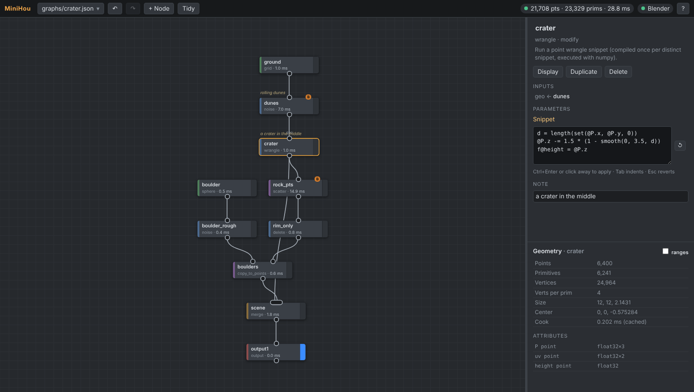

Served by the engine itself (plain HTML/JS, nothing to install or build). Houdini-style: **Tab** (or double-click) adds a node,
wired to the selected one; drag from a node's bottom dot to another node to connect, drag a connected input to re-route or
disconnect; the blue bar is the **display flag** (what Blender shows); **L** tidies the layout, **F** frames, **Ctrl+Z** undoes.
The right side shows the selected node's parameters (sliders, drag a label to scrub, a code box for wrangles, **B** exposes a
parameter to Blender) and an **inspector** with the node's point/prim counts, bounds and attributes. Cook errors are shown on
the failing node. Everything is live: drag a slider in Blender and the editor follows; edit in the editor and Blender follows.
Edits are saved to the graph file (and are undoable, including edits made by an AI). Press **?** for all controls.

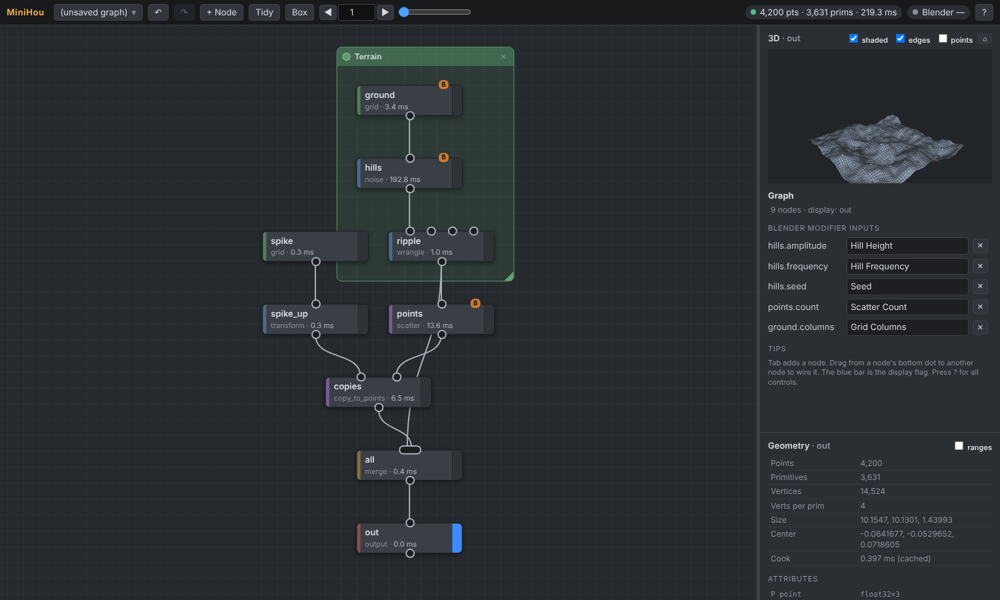

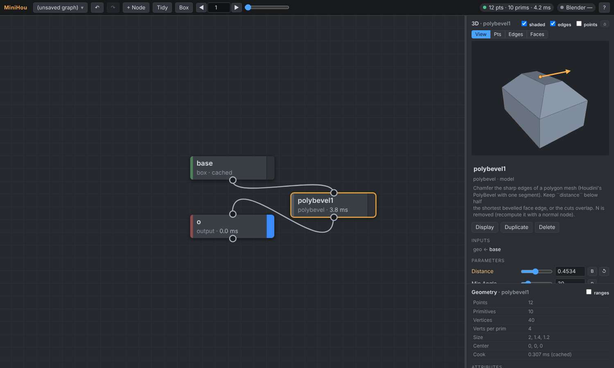

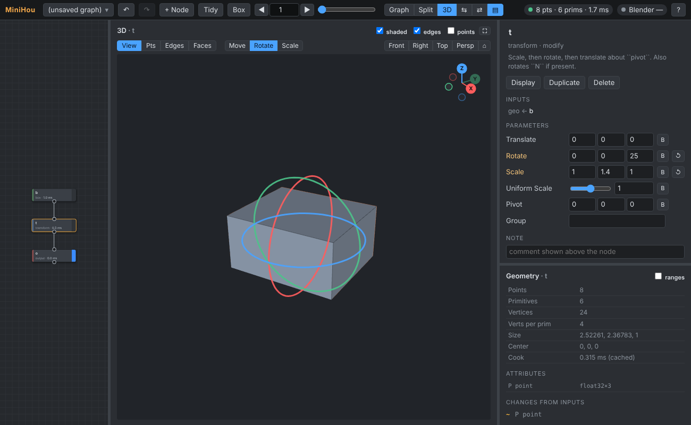

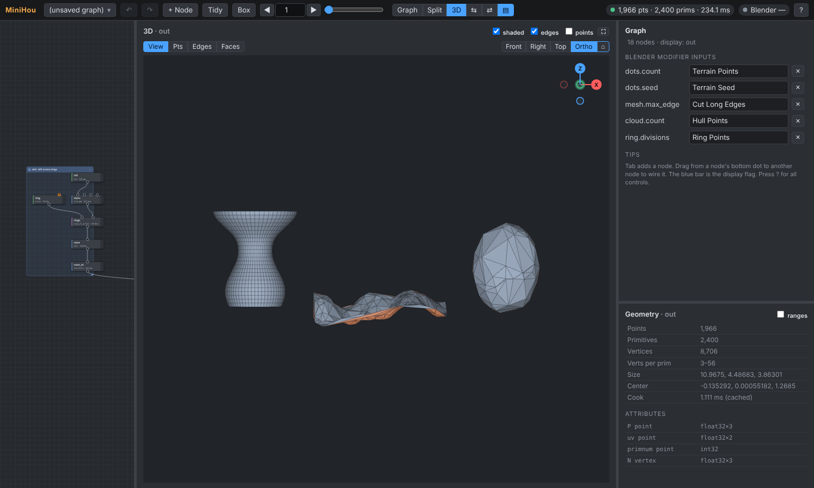

* **Resizable panes**: the graph, the 3-D view and the parameter panel are separate panes with draggable dividers (between graph and
  view, between those and the side panel, and between parameters and the geometry inspector). **Graph / Split / 3D** in the top bar set
  the balance (the 3-D view as the main window, or the graph), **⇆** puts the panes side by side or stacked, **⇄** swaps them, **▤** hides
  the side panel, and **Ctrl+Space** over a pane makes it fill the window (again to go back). The layout is remembered in the browser.
* **3-D view**: a WebGL2 view of the selected node, or the display node when nothing is selected, so the engine is
  usable without Blender. Drag to orbit (Z is up), **Shift**-drag or right-drag to pan, wheel to zoom, double-click to frame. Navigation
  also has **Front / Right / Top** buttons and an axis gizmo in the corner (click an axis ball to look along it; **Numpad 1 / 3 / 7**, with
  **Ctrl** for the opposite side), **Persp / Ortho** (**Numpad 5**), and **Numpad .** / **Home** to frame the selected elements or everything.
  Shaded / edges / points toggles; point colours (`Cd`) are shown; back faces are tinted orange so flipped normals stand out.
  Very large geometry is cut to a drawable size and the view says so.
* **Timeline under the view**: ▶ plays the graph in real time between a start and an end frame (frames are skipped, never queued, when a cook is
  slower than the frame rate), with ⏮ ◂ ▸ ⏭ step buttons, a scrub slider, the current frame, range and fps fields (the fps also sets the engine's
  `@Time`), and ⟲ to loop; **Space** over the view plays or pauses and **←** **→** step (**Shift** jumps to the ends). The range is remembered in the browser,
  and Blender's own timeline still drives the frame when it is connected.
* **Normals** toggle (with shaded / edges / points): a short line from the centre of every face along its normal, worked out from the winding, so
  flipped faces show up pointing inwards.
* **Groups and the path bar**: a group (a `*.json` graph used as a node) is drawn stacked with a ▣ mark; **double-click** it to open its graph. The path
  at the top left of the graph (`welcome › rock_scatter › detail`) lists the groups you went through: click a name to step back out, or press
  **Alt+Up**; it survives a page reload.
* **Select in the 3-D view and build the network from it**: the **Pts / Edges / Faces** buttons under the view (or **1 / 2 / 3** with the
  mouse over it) switch to a selection mode: click to pick (only what you can see), **Shift** adds, **Ctrl** removes, drag a box to
  select everything inside it (X-ray); **Alt**-drag or the middle mouse button orbits, **A** selects all, **Esc** clears then leaves.
  Selected edges are drawn thick, faces tinted. The buttons that appear then add a node **after the node you are looking at and wire it into
  the chain in place** (everything that read that node reads the new one; the display flag moves along): *Bevel* for edges (`polybevel` with
  an `edges` list of point pairs; a bevel cannot end in the middle of a surface, so select a loop or edges that meet or reach a border),
  *Extrude*, *Inset*, *Reverse*, *Group*, *Delete* for faces, *Group* and *Delete* for points. The same `insert` edit op is available to AI
  tools (`{"op": "insert", "after": "id", "type": "polybevel"}`).
* **Piece (object) selection and moving things like Houdini**: the **Piece** button (or **4**) selects a whole connected piece with one click (a copy
  from `copy_to_points`, one box of a merge...; a box drag takes every piece it touches). Anything you select, whether points, edges, faces or pieces,
  shows a **Move / Rotate / Scale** gizmo at its centre. The first drag adds a **`transform`** node after the one you are looking at, with its `group` set
  to the selected points and its `pivot` to their centre, and carries on dragging it; selecting the same thing again edits that node instead of adding another.

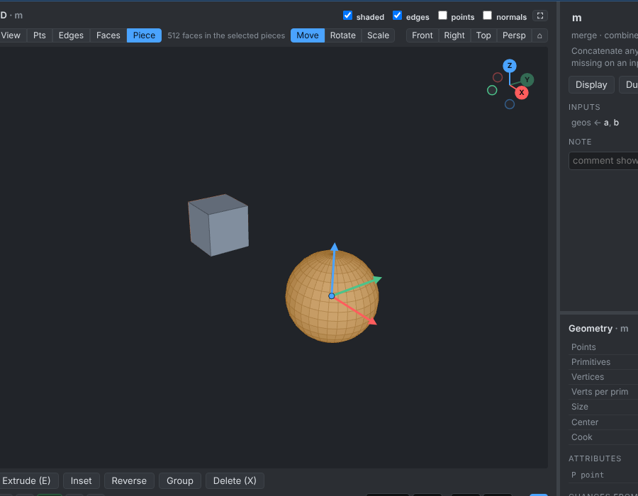

* **Handles (gizmos)**: the node you are looking at can show draggable arrows in the 3-D view: grab an arrow head and drag, and the parameter
  follows live (everything recooks, Blender included). `transform` has **Move / Rotate / Scale** tools (buttons above the view, or **W / E / R**
  with the pointer over it and nothing selected): move arrows, one **ring** per rotation axis (drag around it; the rings turn about the axes
  each Euler angle really uses and sit at pivot + translate, so they stay put while you drag), and **scale cubes** per axis plus a square
  for uniform scale (a drag multiplies the value, so it never goes through zero). `polyextrude` and `polybevel` have a distance arrow
  standing on the selected faces or edges (so the bevel you just made from a selection can be scrubbed straight away), `box` a size
  arrow per axis and `sphere` a radius arrow. Handles are small provider functions in `minihou/handles.py` (inputs, output, parameters ->
  arrows); a failing provider just shows none.
  Any node type can declare handles without code in the viewer: `@node(..., handles=[Handle("height", axis="z", at="bottom", reach=True)])`
  (arrows, rings for angles in degrees, scale cubes; `axis` and `at` can be keywords, vectors or `"@parameter"`). `tube`, `helix`, `line`
  and `bend` use it, and so can the node files in your `nodes/` folder (see the authoring guide the MCP `node_library` tool returns).
* **Attribute flow**: the inspector lists what the selected node did to its inputs' attributes (`+` added, `~` changed, `→` moved to
  another domain, `−` removed, and whether topology changed); a wrangle also lists the attributes its snippet reads. It is worked out
  by comparing cooked results, so it is right for built-in, library and system nodes alike (also in `inspect_node` for AI tools, as `flow`).
* **Network boxes**: **O** (or the Box button) draws a titled, coloured rectangle behind the selected nodes. Drag its title to move
  it with its nodes, its corner to resize, double-click to rename, the dot to change colour. They are saved with the graph and never
  affect a cook.
* **Copy / cut / paste** (**Ctrl+C / X / V**): nodes travel as JSON text through the clipboard, so they can move to another graph or
  another editor window; wires between the copied nodes are kept.

## Build systems with AI (MCP)

The engine includes an [MCP](https://modelcontextprotocol.io) server, so an AI assistant can build and tweak graphs in the running
engine while you watch in the editor and in Blender. One-time setup:

```powershell
py tools\setup_mcp.py      # writes .mcp.json for Claude Code, prints the Claude Desktop config, checks the server starts
```

Then start `claude` in this folder (approve the `minihou` server) and ask, for example:

> Make a new graph graphs/crater.json: a 12 m dune field with a crater in the middle and boulders scattered on the crater rim.
> Expose the boulder count and dune height to Blender.

The assistant gets these tools: `engine_status`, `list_node_types` (every node, input and parameter with ranges and docs),
`get_graph`, `edit_graph` (atomic batches of edit operations; the reply says whether the cook worked, which node failed and why,
and point/prim counts), `inspect_node` (counts, bounds and attribute ranges at any node), `undo`, `list_graphs`, `open_graph`
(also starts the engine if it isn't running), `wrangle_reference` and `node_library` (write brand-new node types in Python,
see below). The screenshots above are from exactly that loop.
The same edit operations are available to scripts over HTTP (`POST /api/edit`, see `minihou/edit.py` and `minihou/web/server.py`).

## Examples

| file | what it shows |
|---|---|
| `examples/graphs/demo.json` | grid + noise hills + wrangle ripple, scattered spikes via copy_to_points |
| `examples/graphs/spiky_sphere.json` | sphere + vector noise, normals, scatter, delete by expression, per-point `pscale` from a wrangle, box spikes |
| `examples/graphs/terrain_rocks.json` | 200x200 terrain with 5-octave noise, a valley wrangle, rocks scattered only above a height |
| `examples/graphs/crater.json` | built by an AI through MCP: dunes, a crater wrangle, boulders kept only on the rim by a `delete` expression |
| `examples/graphs/spiral_stairs.json` | uses the example library nodes `stairs` (spiral treads around a column) and `twist` |
| `examples/graphs/rocky_hills.json` | hills plus the `rock_scatter` **system** (`nodes/rock_scatter.json`, a graph used as a node) |
| `examples/graphs/scifi_panels.json` | random face groups extruded twice with insets, flat-shaded, a second material on the tops |
| `examples/graphs/subd_pod.json` | box -> extruded dome and fin -> clip + mirror (symmetric, welded) -> Catmull-Clark |
| `examples/graphs/curves_vine.json` | helix -> resample -> noise -> blur -> width ramp -> sweep; a wireframe sphere |
| `examples/graphs/lsystem_tree.json` | an L-system tree: branches swept by width, leaves copied onto the `J` points |
| `examples/graphs/eroded_terrain.json` | fractal hills -> droplet + thermal erosion; wet basins (flow) get the second material |
| `examples/graphs/volumes.json` | a box minus a sphere with a smooth fillet (sdf_boolean), metaball blobs (points_to_surface) |

All examples are cooked by the test-suite, so they keep working as nodes evolve.

Rendered in Blender (Cycles) straight from the engine's output:

| | | |
|---|---|---|
| 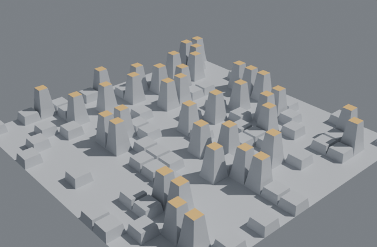 groups + polyextrude | 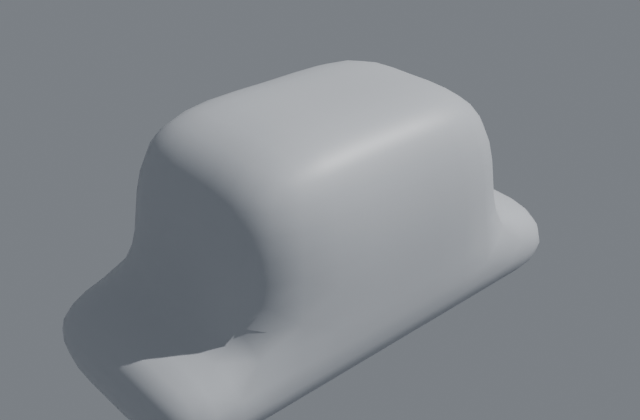 extrude, clip, mirror, subdivide | 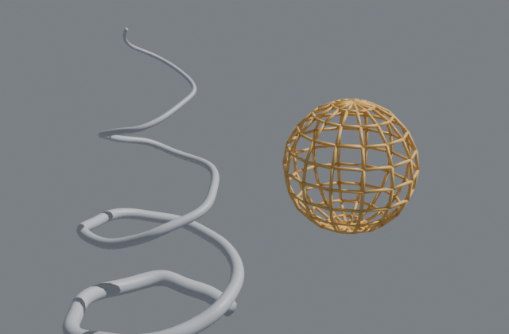 curves: resample, blur, sweep |
| 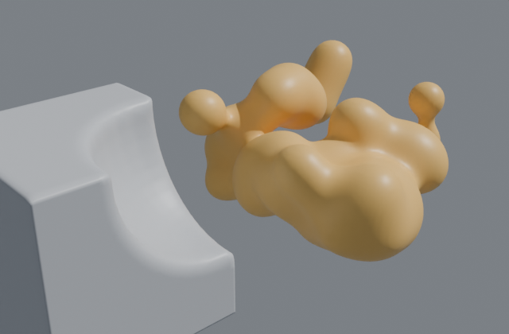 sdf_boolean fillet, metaballs | 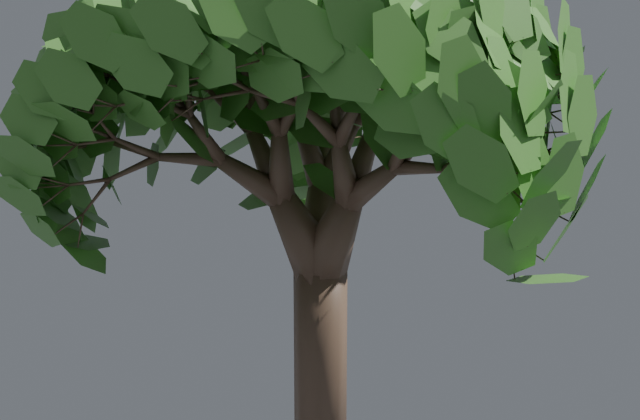 lsystem + sweep + leaves | 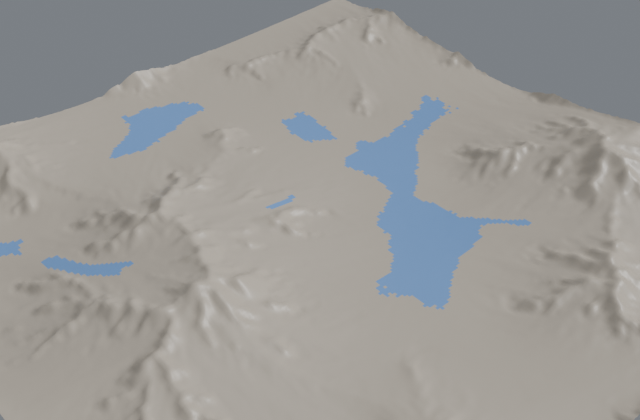 heightfield erosion |
| 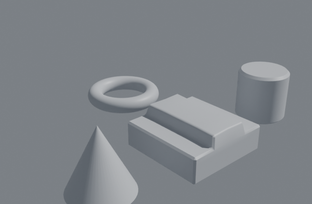 polybevel, tube, torus, cusp normals | 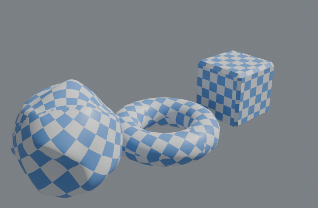 uv_flatten (LSCM), checker texture | 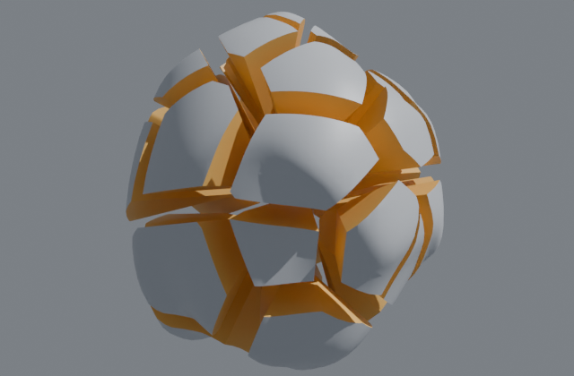 voronoi_fracture, exploded_view, smooth |
| 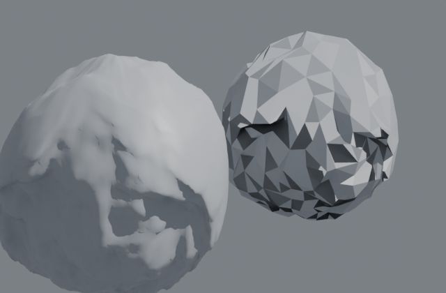 polyreduce to 3% (quadric error metrics) | 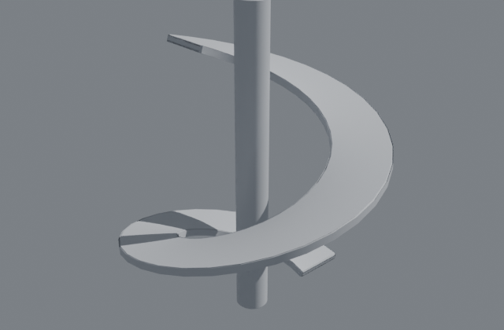 path_deform along a helix (up_vector frames) | 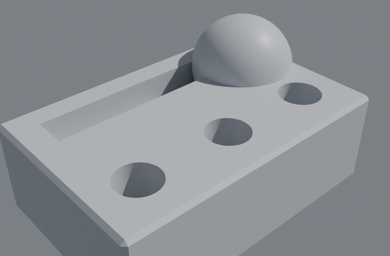 exact boolean: bores, slot, dome |
| 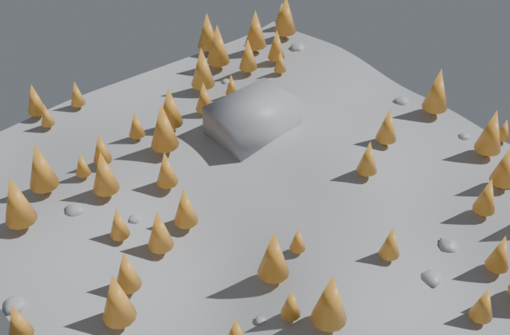 PCG points: sampler, noise filter, house and road differences, self-prune, spawner | 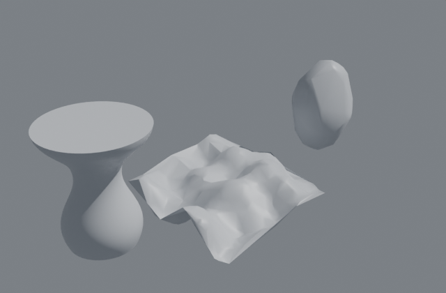 skin (loft), delaunay, convex_hull, network boxes | |

## Nodes

| node | inputs | what it does |
|---|---|---|
| `blender_object` | - | a Blender object's evaluated mesh, **live**: edit it in Blender and the graph recooks (see below) |
| `grid` | - | XY grid of quads; `uv` point attribute |
| `box` | - | closed box, optional divisions (welded seams) |
| `sphere` | - | UV sphere (triangle-fan poles), closed and outward-facing |
| `circle` | - | one filled n-gon |
| `tube` | - | cylinder or cone along Z (top radius 0 ends in a point), optional caps; vertex `uv` |
| `torus` | - | torus in XY, outward quads; vertex `uv` |
| `transform` | geo | scale / rotate (Euler XYZ) / translate about a pivot; rotates `N`; optional group |
| `match_size` | geo | move (centre, or sit on the ground with justify min) and scale (uniform or per axis) to a target box |
| `copy_transform` | geo | copies with an accumulating translate/rotate/scale (stairs, spirals, arrays); point `copynum` |
| `peak` | geo | move points along their normals (optional group) |
| `blend` | geo, targets* | morph the base towards shapes with the same points (shape keys / Blend Shapes): `amount`, per-target `weights` as numbers or expressions (`smoothstep(1, 49, @Frame)`, `sin(@Time * 3) * 0.5 + 0.5`), which attributes (`P`, `N`, `*`), a per-point `mask`, a `group`; several targets add their offsets |
| `bound` | geo | bounding box, world-aligned or fitted to the principal axes; detail `bound_min/max/size` |
| `noise` | geo | fractal Perlin noise; displaces `P` or writes any attribute (scalar or vector mode); optional group |
| `group_create` | geo | a named point or primitive group: pattern/expression, bounding box, normal direction, random %, boundary |
| `group_promote` | geo | convert groups between points and primitives |
| `group_expand` | geo | grow or shrink a group by rings of neighbours (by points or edges); then `grown ^orig` selects the border ring |
| `group_expand` | geo | grow or shrink a group by rings of neighbours (points or edges); `^` patterns then select the border ring |
| `blast` | geo | delete a group of primitives or points (or keep only it) |
| `polybevel` | geo | chamfer sharp edges (min angle, point group); slides along borders and flat edges so subdivided meshes bevel cleanly; moves are limited where faces would fold; new faces in group `bevel` |
| `boolean` | a, b | exact union / subtract / intersect of closed meshes: watertight n-gon output, uv and attributes carried across cuts, groups `from_a`/`from_b`; flush faces cut cleanly |
| `voronoi_fracture` | geo, points | break a closed mesh into the exact Voronoi cells of the points; closed pieces, prim `piece`, caps in group `inside`, optional gap |
| `polyreduce` | geo | reduce to a percentage or count of triangles with quadric error metrics; keeps borders, sharp edges and manifold shells; attributes blend along collapses |
| `exploded_view` | geo | push pieces (a prim attribute) away from a centre |
| `polyextrude` | geo | extrude faces (a group) along their normals with inset; connected regions or individual faces; groups `extrudeFront`/`extrudeSide` |
| `subdivide` | geo | Catmull-Clark or linear; optional semi-sharp edge/corner creases; UVs and groups follow |
| `edge_group`, `edge_group_promote` | geo | Derived edge selections: patterns, endpoint pairs, boundary or point/primitive groups; promote to incident points/primitives |
| `polybridge` | geo | Linear segmented quad bridge between equal-count boundary chains or loops |
| `dissolve` | geo | Merge selected manifold interior edges into simple n-gons; angle and UV/material seam protection |
| `skin` | geo | Skin/Loft through multiple equal-count profiles in primitive order |
| `polyexpand2d` | geo | Miter offsets of independent convex closed planar profiles; arbitrary plane orientation |
| `soft_transform` | geo | Pivoted transform with radial smoothstep or linear falloff and point-group restriction |
| `lattice_grid` / `lattice` | none / geo, rest, deformed | Complete control grid and trilinear lattice deformation |
| `point_deform` | geo, rest, deformed | Weighted local affine deformation from corresponding control clouds |
| `crease` | geo | Set edge sharpness or point corner weights for Subdivide; influence decays per level |
| `mirror` | geo | reflect across a plane, weld the seam, keep or drop the original |
| `clip` | geo | cut with a plane; keep above, below or both (new points interpolate attributes) |
| `polyfill` | geo | close holes with n-gons facing outwards |
| `convex_hull` | geo | the smallest convex closed mesh around the points (Qhull via SciPy, or a numpy incremental hull) |
| `revolve` | geo | spin curves or outlines around an axis (`angle`, `divisions`): vases, wheels, goblets; poles are shared points, corner `uv` |
| `bridge` | geo | join pairs of open boundary loops with a band of faces (quads for equal loops, triangles otherwise); `align`, `twist` |
| `skin` | geo | loft: resample the input curves to one point count and join consecutive curves with quads (`loop`, `cap`) |
| `dissolve` | geo | merge neighbouring faces that are flat within `angle` into n-gons (`group` limits it) |
| `delaunay` | geo | 2-D Delaunay triangulation of the points (`axis`; `max_edge` cuts long triangles); SciPy if installed, else pure Python |
| `divide` | geo | triangulate (fans for convex polygons, ear clipping for concave ones) |
| `reverse` | geo | flip winding (and N) of a group of primitives |
| `facet` | geo | unique points per face (optionally flat normals) |
| `attribute_create` | geo | a constant attribute on any domain (or detail) |
| `attribute_randomize` | geo | random floats, vectors, colors or ints per element, or per piece (`by` = `class`) |
| `attribute_promote` | geo | move attributes between points, primitives, vertices and detail (average/min/max/sum/first) |
| `attribute_transfer` | geo, source | copy point attributes from the nearest source point, with a distance limit and soft edge |
| `attribute_blur` | geo | Laplacian smoothing of P or any float point attribute over the edges |
| `smooth` | geo | Taubin smoothing (removes noise without shrinking) or Laplacian; borders pinned; optional point group |
| `connectivity` | geo | number connected pieces (`class`) on points or primitives |
| `measure` | geo | area, perimeter, mean curvature (1/radius), piece area / volume |
| `color` | geo | Cd: constant, random, random per piece, or a ramp along an attribute |
| `sort` | geo | reorder points or primitives (random, by axis, by attribute, reverse) |
| `ray` | geo, target | project points along a vector, along N, or to the closest point; imports hit attributes |
| `line` / `helix` / `curve` | - | open curves: straight, spiral (cone spirals too), or through typed points |
| `resample` | geo | even spacing along curves (or polygon outlines); adds `curveu` (0 to 1 along each curve) |
| `carve` | geo | keep part of each curve by length (animate `end` to grow it) |
| `fillet` | geo | round the corners of curves and polygon outlines with circular arcs (`radius`, `divisions`, `min_angle`, `group`); arcs are tangent to both segments and share short segments (never overlap); attributes blend along the curve; open curves keep their ends |
| `sweep` | geo | tubes along curves: rotation-minimising frames, radius x point `width`/`pscale`, caps, twist, uv |
| `path_deform` | geo, curve | bend geometry along a curve (minimal-rotation or up-vector frames), offset, stretch to fit, twist; rotates N |
| `convert_line` | geo | every edge to curves (joined into polylines), e.g. wireframes with `sweep` |
| `polypath` | geo | join curves that share end points |
| `lsystem` | - | L-systems: rewriting rules (stochastic too) and a 3-D turtle -> branching curves with `width`, leaf points (`J`) |
| `instance` | points | points become instances of **Blender objects** (random, cycled or by attribute; aligned to N or upright; random spin and scale) |
| `heightfield_erode` | geo (a grid) | terrain erosion: thousands of rain droplets carve gullies and drop sediment, then steep slopes slump; writes `flow`, `erosion`, `deposit` masks |
| `bend` | geo | bend, twist and taper along an axis (capture region; straight beyond it), N follows |
| `point_relax` | points, surface | push points to an even spacing while keeping them on a surface (blue-noise scatter) |
| `point_jitter` | geo | random offsets per axis |
| `clean` | geo | weld, drop repeated corners and degenerate faces/curves, remove unused points |
| `uv_project` | geo | UVs by box (triplanar), planar, cylindrical or spherical projection; seams and poles handled |
| `uv_flatten` | geo | unwrap UVs with least-squares conformal maps: islands cut at sharp edges (or where an attribute changes), closed shapes cut into discs automatically, packed into 0-1 at matching texel density; prim `island` |
| `remesh` | geo | voxel remesh a closed mesh: even watertight quads, offset (grow/shrink), smoothing, attribute transfer |
| `points_to_surface` | points | metaball surface around points (radius x pscale, blend), e.g. blobs and liquids |
| `sdf_boolean` | a, b | union / subtract / intersect of closed meshes through distance fields, with smooth fillets |
| `for_each` | geo | run a node or a system on every piece (connected pieces, an attribute's values, or each primitive) and merge |
| `solver` | geo | feed each frame's result into the next (simulations, growth): deterministic, incremental playback, substeps |
| `python` | geo, opinput1..3 | real Python inside the graph: geometry and variables piped in, you set `out`; **off unless the engine runs with `--allow-python`** |
| `wrangle` | geo | VEX-like snippet over points, primitives or vertices (see below) |
| `attribute_delete` | geo | delete attributes by name or wildcard (`N uv tmp_*`) |
| `attribute_rename` | geo | rename an attribute, e.g. a Blender color attribute `Col` to `Cd` |
| `normal` | geo | area-weighted point normals, face normals (Newell, n-gon safe), or vertex normals with a cusp angle (hard edges stay sharp; Blender gets custom normals) |
| `scatter` | geo | area-weighted random points on the surface (`P`, `N`, `primnum`), or uniformly inside a closed mesh (mode volume: ray-parity inside test) |
| `copy_to_points` | source, points | stamp `source` on every point, oriented by `orient` (quaternion), `rot`, or `N` + `up`, sized by `scale` x `pscale`; inherits point attributes |
| `delete` | geo | delete points matching an expression (and primitives that use them), compacting all attributes |
| `fuse` | geo | weld points closer than a distance |
| `merge` | geos (any number) | concatenate; missing attributes are zero-filled |
| `switch` | geos... | pass on one of the inputs by index |
| `output` | geo | marks what the live link publishes (validated) |

### Groups

As in Houdini, a group is a named selection of points or primitives, stored as the int attribute `group_<name>` (1 =
member): a wrangle reads `@group_top` and makes one with `i@group_tall = @P.z > 2`, groups survive every node that carries
attributes, and Blender gets each as a boolean attribute (use it with *Named Attribute* in Geometry Nodes). Nodes with a
**group** field (`wrangle`, `transform`, `noise`, `blast`, `group_create`) take a pattern:

| pattern | selects |
|---|---|
| `top side`, `rock_*` | union of groups (wildcards) |
| `top ^side`, `^side` | remove a group (a leading `^` starts from everything) |
| `0-9 20 30-60:2` | element numbers, ranges, steps |
| `@P.z > 0` | an ad-hoc group: a wrangle expression |
| (empty) | everything |

A point group used on primitives selects those whose points are all in it; a primitive group used on points selects
the points its primitives use.

### Curves

Like Houdini's open polygons, a **curve** is a primitive whose points are not closed into a face (`@closed` is 0 in a
wrangle over primitives). Curves flow through the nodes that make sense for them (transform, noise, wrangle, groups,
merge, copy_to_points, attribute_blur, measure `perimeter` = length...) and polygon-only nodes (subdivide,
polyextrude, clip, polyfill) say so; `blast` with group `@closed == 0` separates them. Deleting points from a curve
shortens or splits it. In Blender, curves arrive as **loose edges** of the output mesh (use *Mesh to Curve* in Geometry
Nodes for real curves), and a `blender_object` reads loose edges back as curves. For render geometry, `sweep` them.

### Instancing Blender objects

`instance` turns points into instances of objects in your Blender file (trees, rocks, props): the engine picks the
object and the rotation and scale per point (`instance`, `rot`, `scale` point attributes, the object list as the detail
`instance_objects`), and the Geometry Nodes proxy places them with *Instance on Points*, so a million instances cost a
million points on the wire, not a million copies, and the objects stay editable in Blender (edit the tree, every
instance follows). Merge instance points with other geometry freely: lists from several `instance` nodes are combined.
Missing objects are reported in the add-on panel's log and place nothing.

### Volumes

`remesh`, `points_to_surface` and `sdf_boolean` are Houdini's VDB workflow collapsed into mesh-in, mesh-out nodes: the
input becomes a signed distance field on a voxel grid (exact distances near a closed mesh, the inside found by
flood-filling the outside), the field is offset, smoothed or combined, and surface nets turn it back into a watertight
quad mesh (face saddles are resolved, so edges stay manifold). Booleans this way never fail on coplanar or messy input;
edges are as sharp as the voxel size. Cost grows with (size / voxel size)^3, so start coarse.

### Time, loops and solvers

Blender's timeline drives the engine: wrangles read `@Frame`, `@Time` (seconds, frame 1 = 0) and `@TimeInc`, as in
Houdini, and only nodes whose parameters mention them recook when the frame changes (keyframed modifier inputs keep
working as before). `for_each` runs any node type -- typically a **system** graph -- on each piece, with `@iteration`,
`@numiterations` and `@value` readable inside (detail attributes read as constants). `solver` applies its body to the
previous frame's result: e.g. body `wrangle` with params `{"snippet": "v@v += set(0, 0, -9.8) * @TimeInc; @P += @v *
@TimeInc"}` drops points under gravity. A given frame always gives the same result, playing forward steps once per
frame, and scrubbing back is served from memory.

### Wrangle snippets (the attribute wrangle)

```
@P.z += sin(@P.x * 2) * 0.5                       # read/modify attributes; .x .y .z .w components
v@Cd = set(fit(@P.z, -1, 1, 0, 1), 0, 1)          # f@ i@ u@ v@ p@: float, int, vector2, vector, vector4
f@mask = 1 if length(@P) < 3 and @P.z > 0 else 0  # conditionals and boolean logic
h = noise(@P * 0.3); @P += @N * h                 # locals; several statements (; or new lines)
i@id = @ptnum                                     # @ptnum @primnum @vtxnum @numpt @numprim @numvtx; PI, E
```

`run_over` picks the domain: **points**, **primitives** (faces) or **vertices** (face corners, Blender's corners). Other
domains can be read: over vertices, point and primitive attributes (`@P` is the corner's point); over primitives, point and
vertex attributes averaged over the face (`@P` is the face centre). Writing a name moves the attribute to the domain being
run over: an attribute name lives on one domain, as in Blender. Examples:

```
u@uv = set(@P.x, @P.y) * 0.1                      # over vertices: a planar UV map (Blender: "UVMap")
i@material_index = 1 if @P.z > 2 else 0           # over primitives: high faces get the second material
v@Cd = set(rand(@primnum), 0.2, 0.5)              # over primitives: a random colour per face
```

`attribute_delete` (wildcards) and `attribute_rename` tidy up, e.g. delete `N` to let Blender compute its own normals.

**Blender-native attributes.** Engine attributes reach Blender as real Blender data, so materials, UV tools and modifiers
just work (and the Geometry Nodes proxy carries them):

| engine attribute | in Blender |
|---|---|
| `uv` (any domain, 2+ components) | UV map **UVMap** on face corners, active for render |
| `Cd` (3 or 4 components; points, vertices or faces) | color attribute **Color** (points or corners), active for render; use it in a shader with a *Color Attribute* node |
| `N` (points, vertices or faces) | custom normals (Blender 4.5+: the `custom_normal` attribute, 7 ms for 1M points) |
| `material_index` (primitives, int) | each face's material slot |
| `sharp_face` (primitives) | flat shading for those faces (others smooth) |
| anything else | a generic attribute of that name: POINT / CORNER / FACE, float, float2, vector, color (4 floats), int, bool; read it with an *Attribute* shader node or Named Attribute in Geometry Nodes |

**Reading Blender objects.** A `blender_object` node streams an object from the open Blender file into the graph: its
evaluated mesh (modifiers applied), in world or object space, with Blender's own data as attributes. The add-on sends the
objects the graph names (and only those) whenever they change, at most 10 times a second each; unchanged data is not resent.

| in Blender | engine attribute |
|---|---|
| the render UV map | `uv` (vertices); other UV maps keep their names |
| the render color attribute | `Cd` (3 floats) plus `Alpha` when not opaque, on its own domain |
| vertex groups | a point float named after the group (`@lift`); skipped above 250k points, where a Geometry Nodes *Store Named Attribute* makes them real attributes |
| `material_index`, `sharp_face` | primitive ints |
| custom normals | vertex `N` (only when the mesh has custom normals) |
| any other attribute | the same name: POINT -> point, CORNER -> vertex, FACE -> primitive |

So a wrangle can do `@P += @N * @lift` with a group painted in Blender, or `i@material_index = @material_index + 1`. The
inspector (and the MCP `inspect` tool) lists what was read for a `blender_object` node, including anything skipped (edge
attributes: the engine has no edge domain). MiniHou's own objects cannot be read (that would feed the output back into itself),
and `blender_object` belongs in the main graph: a system takes geometry through an `input` node instead.

Functions: `sin cos tan asin acos atan atan2 sqrt exp log abs floor ceil frac pow sign min max clamp lerp fit smooth length
normalize dot cross set noise rand select radians degrees`. A float times a vector works as in VEX. Snippets are compiled once
(cached by text) to numpy and are **sandboxed**: they are parsed and checked against a whitelist, so a shared graph file cannot run
arbitrary Python (imports, attribute access, strings, builtins... are rejected before anything runs; 42 attack patterns are tested).
Typical snippets take 20-50 ms on 1M points. The `delete` node takes a wrangle *expression* (`@P.z < 0`).

## PCG points (like Unreal Engine's PCG graph)

PCG nodes treat points as oriented boxes: `P`, `rot` (Euler XYZ radians), `scale`, `bounds_min`/`bounds_max` (the box
in the point's frame), `density` (0..1) and `seed` (per point, so random choices follow the point). Missing attributes
take defaults, so any points work. The booleans test exact box overlaps (separating axes), or the inside of a closed
mesh.

| node | inputs | what it does |
|---|---|---|
| `pcg_surface_sampler` | surface | points per square metre, blue-noise spacing (looseness), optional alignment to the surface |
| `pcg_volume_sampler` | volume | a grid of points inside a closed mesh, each box its voxel |
| `pcg_spline_sampler` | curve | points along curves (X along the tangent) or filling closed curves |
| `pcg_points` | geo | any points (a mesh's, a scatter's) as PCG points |
| `pcg_transform` | points | random offset / rotation / scale ranges, seeded per point |
| `pcg_bounds` | points | set or scale the boxes |
| `pcg_density_noise` | points | random or Perlin density (set, multiply, add, min, max) |
| `pcg_distance` | points, target | density from the distance to a mesh, a curve or points |
| `pcg_density_filter` | points | keep a density range, or keep each point with probability = density |
| `pcg_difference` | points, subtract | drop points whose boxes overlap the other input's boxes or a closed mesh (binary), or lower their density by the covered fraction |
| `pcg_intersection` | points, other | keep the overlapping points (binary) or scale density by the covered fraction |
| `pcg_union` | inputs... | merge point sets; optionally max/add densities where they overlap |
| `pcg_self_prune` | points | drop overlapping points: larger, smaller, denser or random first; the same result as a sequential greedy pass |
| `pcg_projection` | points, surface | drop points onto a surface along a direction, optionally aligned to its normal |
| `pcg_copy_points` | source, targets | the source points on every target, transforms composed |
| `pcg_spawner` | points | weighted Blender objects (`Tree:3 Rock:1`) as instances; also `variant` for copy_to_points branches |
| `pcg_debug` | points | each point as its box, coloured by density |

## Writing a node

### The python node (code inside the graph)

For a quick one-off you do not need a library file: a `python` node holds the code in its **code** box (editor: the code panel,
same as a wrangle). The geometry you wire in arrives as `geo`, `input1`, `input2`, `input3` (read-only: copy before editing),
`np` is numpy, and you set `out` to the result, a `Geometry` or an `(n, 3)` array of points (leave it out to pass `geo` through):

```python
P = geo.P.astype(np.float64)
P[:, 2] += a * np.sin(P[:, 0] * b) + factor        # a, b: sliders; factor: a named value from the Variables field
out = geo.copy()
out.point["P"] = P.astype(np.float32)
out.detail["bumps"] = int(i)                       # detail attributes reach Blender as custom properties
```

Variables piped in: `a b c d` (floats), `i j` (ints), `v` (x, y, z), `s` (text), `flag` (bool) are ordinary parameters, so they
can be exposed to Blender and keyed; the **Variables** field takes any number of `name = value` lines (numbers, text, lists,
True/False); `Frame`, `Time`, `TimeInc` give the time (tick **animated** so the node recooks on every frame). Treat it as a pure
function of its inputs and parameters: results are cached like any node. Errors name the line of your code.

**It is off by default.** A graph file can carry code, and a node that runs it would execute whatever a downloaded (or
AI-written) graph says. Start the engine with `--allow-python` (`py tools\launch_blender.py --engine g.json --allow-python`, or set
`MINIHOU_PYTHON_NODES=1`) for graphs you trust; nothing inside a graph can switch it on, and without the switch the node
fails with a message saying so. Wrangles stay sandboxed and are always available.

### Node libraries (hot-reloaded)

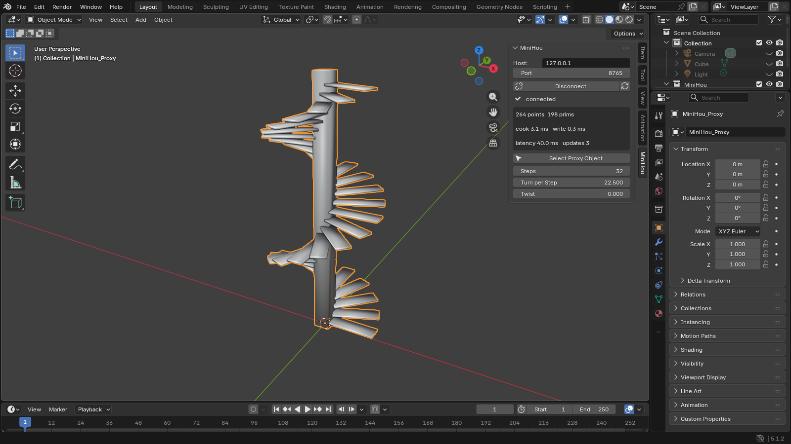

Any `*.py` file in the workspace's `nodes/` folder is loaded by the engine and **re-loaded whenever you save it**: its `@node`
functions appear in the editor's Tab menu (and to AI tools) within a second, and graphs using them recook. Nothing to restart.

```powershell
py -m minihou new-node ripple_rings        # writes nodes\ripple_rings.py from a template; edit and save
```

* Cache-safe: each library node's cache key includes a hash of its file, so editing code never serves stale results.
* Failure-safe: a syntax error or exception keeps the previous version loaded; the error (file and line) shows in the editor
  and in AI tool replies. Runtime errors inside a node name the file and line too.
* A library node cannot take the name of an existing node. Graphs that use a node type which disappeared still open (the
  cook reports the missing type) and round-trip unchanged.
* `nodes/twist.py` (a deformer) and `nodes/stairs.py` (a generator that builds topology with numpy; spiral mode above) are
  examples; `examples/graphs/spiral_stairs.json` uses both. `serve --nodes DIR` adds folders.
* Library files are Python running inside the engine, trusted like any script you run. Opening a graph never runs code.

AI assistants use the same mechanism: the MCP `node_library` tool explains how to write a node and reports load errors, and the
assistant writes the file with its normal (permission-checked) file tools. There is deliberately no MCP tool that writes code.

### Systems: graphs as nodes

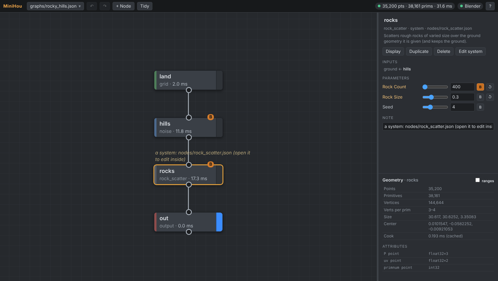

A graph file saved in the node folder is itself a node type, named after the file, like a Houdini digital asset:
`input` nodes inside it are its inputs, its **exposed parameters become the node's parameters**, its display node is the
output and its top-level `"doc"` is the description. `nodes/rock_scatter.json` is an example (scatter rough rocks of varied
size over whatever ground you wire in); `examples/graphs/rocky_hills.json` uses it. Build one by opening
`nodes/<name>.json` in the editor (File > New graph) or asking an AI; while editing, wire a stand-in into an `input` node's
`preview` port. Select a system node and press **Edit system** to open it; saving re-loads it everywhere. Systems can use
other systems and Python library nodes; each system's cache key covers the code of everything inside it, so editing a
nested system or a Python node updates every graph that uses it. A system that uses itself is reported, not looped.

### The SDK

```python
from minihou.sdk import node, Float, Vec3

@node("my_offset", inputs=["geo"], params=[Vec3("offset", (0, 0, 0)), Float("scale", 1.0, min=0)])
def my_offset(geo, offset, scale):
    out = geo.copy()                      # shallow: untouched arrays stay shared (and are not re-sent to Blender)
    out.point["P"] = geo.P * scale + offset
    return out
```

A node is a pure function of its inputs and parameters (the cache depends on that). Inputs are frozen (read-only arrays),
so mutating one raises immediately instead of corrupting the cache. Bump `version=` when you change a node's behaviour.

## Graph JSON

```json
{
  "version": 1,
  "nodes": {
    "ground": {"type": "grid", "params": {"columns": 60, "rows": 60}},
    "hills":  {"type": "noise", "params": {"amplitude": [0, 0, 1.2]}, "inputs": {"geo": "ground"}},
    "out":    {"type": "output", "inputs": {"geo": "hills"}}
  },
  "display": "out",
  "exposed": [{"name": "Hill Height", "node": "hills", "param": "amplitude"}]
}
```

`exposed` entries become modifier inputs in Blender (float, int, bool and vec3 parameters; the parameter's doc string
becomes the tooltip). Nodes may also carry editor data (`"pos": [x, y]`, `"comment": "..."`), which never affects cooking.
The running engine saves every edit (editor, AI, Blender slider) back to the file within a quarter second, and reloads the file
when something else changes it, so the file and every view stay in sync. Saved files stay diff-friendly: short arrays on one
line, whole numbers as ints, and values from Blender's float32 sliders snapped to their shortest decimal (`0.22`, not
`0.2199999988079071`). Inputs that survive a reload keep their identity, so
keyframes and drivers on them keep working. A graph may be unfinished (an unwired node): it still opens, and only the nodes
feeding the display node have to be valid for it to cook.

## Speed

Measured with `bench/bench_link.py` (1M points, Blender 5.1.2). Windows numbers are from the GitHub Actions Windows runner
(re-measured on every CI run; see the "Blender 5.1 on Windows" job log), Linux from Claude's 4-core sandbox.

| 1M points | Windows (CI) | Linux |
|---|---|---|
| positions over the socket (12 MB) | 2.4 ms | 6 ms |
| Blender write (`foreach_set`) | 0.4 ms | 1.0 ms |
| raw update, end to end | **2.9 ms** (~350/s) | 7 ms |
| slider edit, grid + noise, end to end (numba) | **52 ms** | 29 ms |
| first full frame: Blender mesh build (1M quads) | 406 ms | 240 ms |

Smaller graphs on Linux (slider edit, end to end): 10k points 1.5 ms, 100k 4 ms, 250k 6.6 ms (numba); numpy-only is 2-11x slower.
Per node at 1M points with numba vs numpy: noise 12.7 vs 283 ms, 4-octave noise 46 vs 1106 ms, scatter 160 vs 1012 ms,
copy_to_points (1M copies) 134 vs 536 ms, normal 63 vs 662 ms.
Mesh queries (`raycast.TriGrid`: closest point and ray casts, behind `remesh`, `sdf_boolean`, `ray`, scatter-in-volume and the
PCG samplers) also have compiled kernels: remesh of a 4,800-triangle sphere at 0.03 voxels takes 3.5 s vs 17 s, 20k closest-point
queries against a 38k-triangle mesh 1.6 s vs 89 s, 5k inside tests 0.02 s vs 0.4 s. Results match to rounding.

Two findings made the Blender side fast: `mesh.vertices.foreach_set("co")` walks per-vertex RNA structs (165 ms for 1M points) while
`mesh.attributes["position"].data.foreach_set("vector")` is a memcpy (~1 ms); likewise `.corner_vert` (1.3 ms) vs
`loops.foreach_set("vertex_index")` (337 ms for 4M corners). The writer uses the fast paths and falls back to the classic API if a
Blender version changes them. Topology rebuilds (only when connectivity changes) are dominated by Blender's own edge computation.

### Reliability of the numba backend

* **Optional**: without numba (or with `MINIHOU_NO_NUMBA=1`) the numpy code runs; the whole suite runs both ways in CI.
  `py -m minihou serve` prints the active backend.
* **Same algorithm**: kernels use the same hash, RNG stream and float32 coordinate math as the numpy code; parity tests (mutation-checked)
  and **golden values** pin results across platforms, numpy versions and backends.
* **A broken JIT cannot fail a cook**: a kernel error switches acceleration off for the process and the cook finishes on numpy.
* **No timing-dependent results**, **thread-safe launches** (numba's default threading layer would abort on concurrent launches).
* **Start-up**: kernels compile once (~4 s, in the background after `serve` starts) and are cached on disk (~0.15 s afterwards).

## Automated checks (what Claude runs, what you can run)

```powershell
py -m unittest discover -s tests -t .                  # 470+ tests; Blender ones skip without bpy, browser ones without playwright
py tools\launch_blender.py --selftest                  # add-on tests inside `blender --background`, engine as a separate process
py tools\launch_blender.py --bench -- --points 1000000 # the 1M-point benchmark inside Blender (add --mode engine for slider edits)
py tools\launch_blender.py --gui-test                  # interactive smoke test in a real Blender window (~30 s)
```

`--gui-test` opens a normal Blender window and lets Blender's own event loop drive the add-on: Connect operator, panel drawn by the
real UI, a 30-step slider drag forwarded by the depsgraph handler, an idle period proving there is no feedback loop, and two graph
reloads (adding, removing, reordering inputs) while the sidebar and Blender's modifier panel show them. It prints PASS/FAIL per check,
saves screenshots to `gui_test_output\`, and closes Blender. `-- --reload-cycles 40` adds a stress test. On Linux it clicks the
sidebar's MiniHou tab with xdotool; elsewhere (no OS input) it shows a copy of the panel in the active sidebar tab, so the
add-on's draw code always runs in Blender's real sidebar and the "panel drew" checks need real draws on every OS.

The editor is tested in a real headless Chromium (`tests/test_editor_e2e.py`: clicks, Tab menu, wire drags, undo, wrangle
errors, live updates from other clients, and that text from graph files can never become HTML); install
`py -m pip install playwright` and `py -m playwright install chromium` to run those locally.

CI (`.github/workflows/ci.yml`) runs on every push: engine tests on Ubuntu and Windows (Python 3.11-3.13, with and without numba,
`EncodingWarning` as an error); on Windows, Blender 5.1.2 is downloaded and `--selftest`, `--bench` and `--gui-test` run (the GUI one
with Mesa's software OpenGL next to `blender.exe`). Screenshots and logs are uploaded as artifacts.

## Verified vs not verified

Verified:
* **Windows**: engine tests (Python 3.12 + numba, 3.13 numpy-only), the add-on self-test in real Blender 5.1.2 for Windows, the
  benchmark, and the interactive GUI smoke test (software OpenGL) all pass in CI.
* **Linux**: the same, plus repeated GUI runs and a 40-reload stress run in a real Blender window with screenshots; Python 3.11
  (numpy 1.26), 3.12, 3.13.
* **A Windows 11 desktop** (Python 3.14, numba 0.68): engine tests, `--selftest` and `--gui-test` in Blender 5.1.1 and 5.2.1 LTS.
  Blender 5.2 removed ID properties from modifiers; the add-on reads/writes Geometry Nodes inputs through
  `proxy.get_input`/`set_input`, which use `mod.properties.inputs.<Socket>.value` there and `mod["<Socket>"]` before. Keyframe/driver
  paths differ accordingly (`proxy.input_data_path`).
* **Editor + MCP + Blender together** (Linux, Blender 5.1.2 window): an MCP client built the crater system from a starter graph,
  then changed it; Blender showed each step (exposed values pushed into the modifier, 29 ms end to end) while the editor followed.
* Not fooled by flaky timing: Blender tests wait for convergence; cross-platform determinism is pinned by golden values.

Found by these checks and fixed: float32 round-trips causing phantom parameter edits; depsgraph churn from re-assigning the node group;
greyed-out ("unused") modifier inputs; interface rebuilds dropping keyframes/drivers; Windows text-encoding hazards; tests that assumed
fixed timing.

Not verified:
* **Your machine**: a real GPU driver, your Python/numba install, Blender 4.2-5.0 (the add-on declares 4.2+).
* Known Blender behaviour, not reachable through the add-on's UI: showing the MiniHou panel as a *keep-open popover*
  (`wm.call_panel(..., keep_open=True)`, which nothing in the add-on does) during a graph reload crashes Blender 5.1.2 in its UI code
  (reproducible with `--gui-test -- --popover-during-reload`; seen on Windows CI as well, when an earlier version of the test
  left its popover open). The sidebar and the modifier panel are safe across 100+ reloads. The GUI test now detects a Blender crash
  report and stops at once instead of waiting behind the Windows error dialog.

## Known limits

* One exposed-parameter set per engine (the display branch); extra outputs are plain mesh objects without a modifier or exposed
  parameters. Detail attributes reach Blender as custom properties (numbers, text and short number lists only).
* Curves reach Blender as loose mesh edges: their point attributes come along, their primitive and vertex attributes
  do not (Blender has no domain for them). No edge-domain attributes (e.g. `sharp_edge`, `crease_edge`), in either
  direction. A `blender_object` reads meshes (and what Blender can convert to one, e.g. text and curves with geometry).
* The socket and the HTTP API are unauthenticated and bound to loopback by default. Do not bind them to a public interface.
  The HTTP API refuses requests from other web sites (Host/Origin checks against DNS rebinding and cross-site requests) and
  only opens `.json` files inside its workspace folder.
* Editing an example graph saves into it (use the editor's *New graph...* or copy it first; `git checkout` restores it).
* Ints with 3 components, strings and 64-bit attribute types are skipped with a warning.

## Layout

```
minihou/                  the engine (numpy + stdlib, optional numba; never imports bpy)
  geometry.py             AttrTable / Topology / Geometry: point, vertex, prim, detail attribute tables
  sdk.py                  @node decorator, Float/Int/Bool/Str/Vec3/Enum params, Input/Output ports, Registry
  graph.py                Graph model, validation, JSON load/save, exposed parameters
  evaluator.py            pull-based cook, hash-keyed LRU cache, per-cook stats
  wrangle.py              sandboxed snippet compiler (AST whitelist -> numpy)
  accel.py                optional numba backend: availability, safe kernel launch, fallback, warm-up
  nodes/                  one module per node family; nodes/_kernels.py holds the numba kernels
  edit.py                 graph edit operations (add/connect/set/expose/... + layout), atomic batches
  summary.py              geometry summaries for the inspector and AI tools
  link/                   protocol.py + client.py (shared with the add-on), diff.py, session.py, server.py
  web/                    HTTP API + live events (server.py) and the node editor (static/)
  mcp.py                  MCP server for AI assistants (stdio, stdlib only)
  library.py              node libraries: load and hot-reload nodes/*.py, authoring guide
nodes/                    example node library: twist.py, stairs.py (Python) and rock_scatter.json (a system)
blender_addon/minihou_link/
  runtime.py              main-thread timer, depsgraph handler, feedback-loop guards
  mesh_writer.py          foreach_set writer (fast attribute paths)
  proxy.py                output/proxy objects, node group sync (incremental), modifier values
  state.py                bpy-free inbox + parameter forwarder
tools/   launch_blender.py, blender_bootstrap.py, blender_selftest.py, gui_smoketest.py, sync_addon.py,
         setup_mcp.py, mcp_server.py
bench/   bench_link.py, raw_sender.py
tests/   unit, integration, Blender (bpy), golden values, portability
examples/graphs/  docs/  .github/workflows/
```

## RBD physics

Optional real rigid-body dynamics, falling fracture pieces and a projectile/brick-wall
demo are documented in [docs/RBD.md](docs/RBD.md). Install the `physics` extra or use
the prepared Windows RBD runtime. Existing geometry workflows do not require it.
